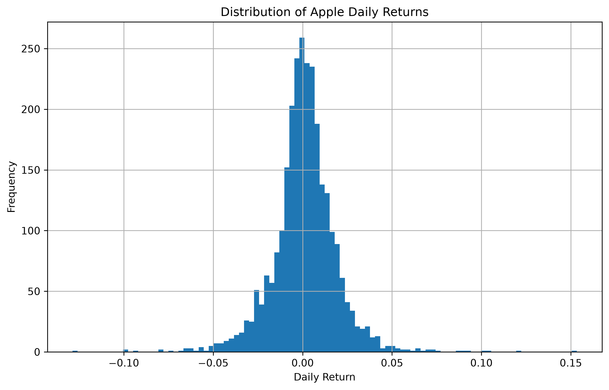
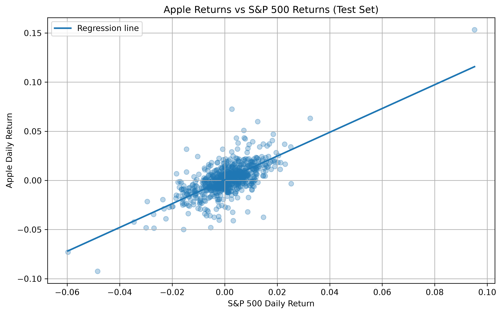
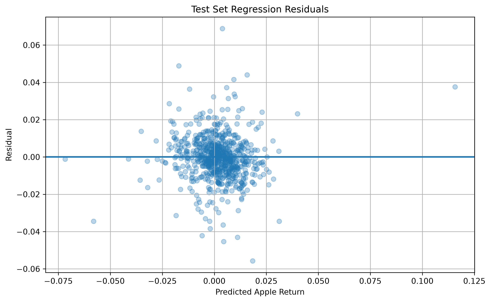

# Stock Return Regression Analysis

## About

This project looks at the relationship between Apple's daily stock returns and the S&P 500.

I used historical data from 2015 to 2025 and Python to calculate daily returns, look at some basic statistics, and build a linear regression model using the S&P 500 to explain Apple's returns.

I also split the data into a training period and a test period to see how well the relationship held up on data the model had not seen before.

## What I did

* Downloaded Apple and S&P 500 price data using `yfinance`
* Calculated daily returns
* Calculated basic statistics such as volatility and correlation
* Built a linear regression model
* Used 2015–2022 as training data
* Used 2023–2025 as test data
* Looked at the model's residuals
* Created graphs to visualise the results

The regression model was:

$$
R_{Apple} = \alpha + \beta R_{Market} + \epsilon
$$

where the S&P 500 return is used to explain Apple's return.

## Results

The model had an **R² of 0.5812** on the training data and **0.4727** on the test data.

This means that the model explained around 58% of the variation in Apple's returns during the training period and around 47% during the later test period.

The lower test R² was expected, since the model had not seen this data before. However, it still explained a substantial amount of the variation, suggesting that the relationship between Apple and the wider market remained reasonably strong.

## Graphs

### Apple's daily returns

### Apple vs S&P 500 returns

### Regression residuals

## What I learned

This project gave me experience working with financial data in Python and using regression to investigate relationships between variables.

It also gave me some experience with evaluating a model on unseen data rather than only looking at how well it fits the data it was trained on.

## Limitations

The model only uses the S&P 500 to explain Apple's returns, so it doesn't account for other factors that can affect the stock.

It also looks at a historical relationship, which does not necessarily mean the same relationship will continue in the future.

## Tools

Python, pandas, NumPy, Matplotlib, scikit-learn and yfinance.
